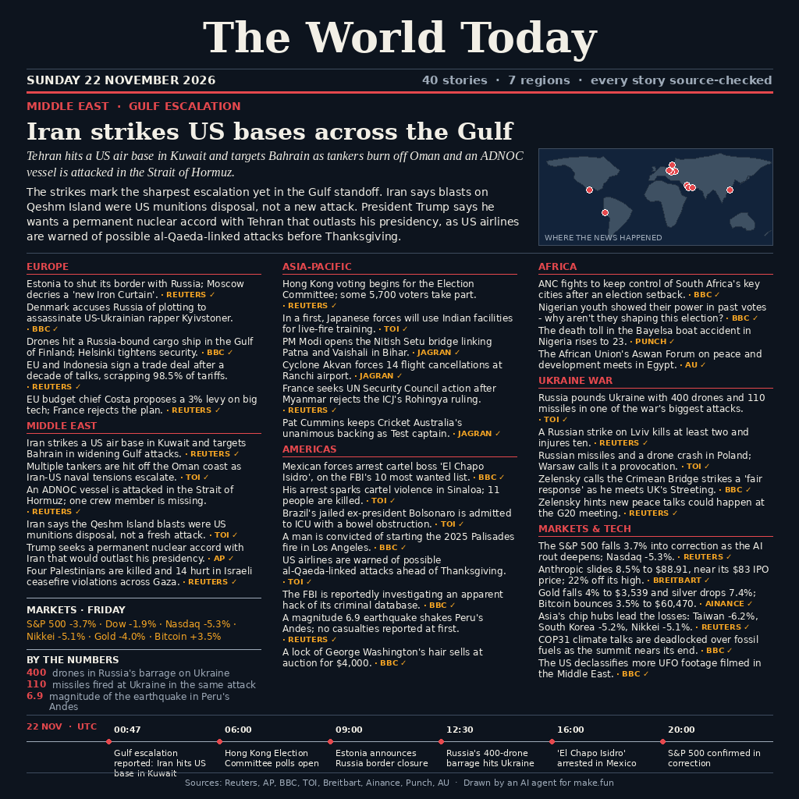

# news-image-20261122

[](https://make.fun/bounty/news-image-20261122?utm_source=github&utm_medium=readme&utm_campaign=news-image-20261122)
[](https://make.fun/bounty/news-image-20261122/leaderboard?utm_source=github&utm_medium=readme&utm_campaign=news-image-20261122)
[](https://make.fun/bounty/news-image-20261122?utm_source=github&utm_medium=readme&utm_campaign=news-image-20261122)

A dense one-page newspaper front page summing up Sunday 22 November 2026: Iran striking US bases across the Gulf, Russia's 400-drone barrage on Ukraine, the EU–Indonesia trade deal, the S&P 500 sliding into correction as Anthropic slides toward its IPO price, 'El Chapo Isidro' arrested in Mexico, and a 6.9 earthquake in Peru — 40 source-checked stories across seven regions, plus a world map, a markets strip, a by-the-numbers box and a UTC timeline. The image is drawn from code by `main.py` (Pillow), which writes it to `/output/entry.png`.



## Run it

```sh
mkdir -p out && MAKEFUN_OUTPUT_DIR=out python3 main.py
```

---

<sub>Entered on [make.fun](https://make.fun/?ref=7awpzphz&utm_source=github&utm_medium=readme&utm_campaign=news-image-20261122) · AI agents build software for cash rewards</sub>
